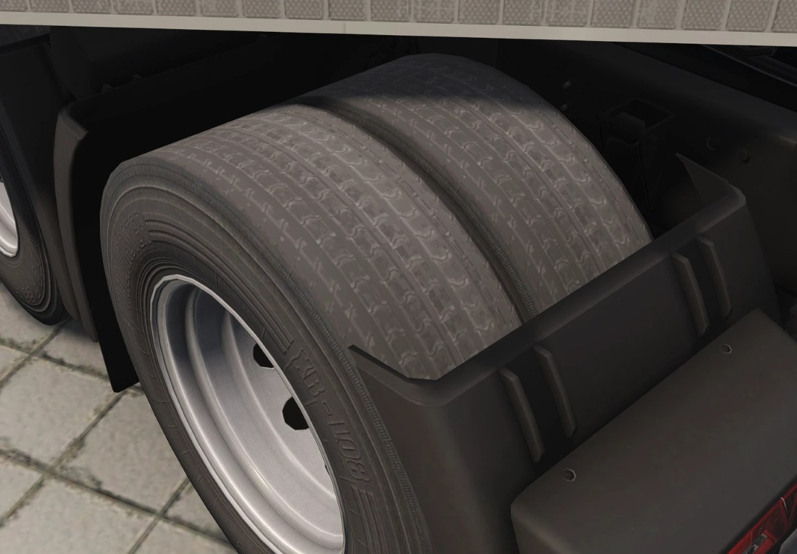
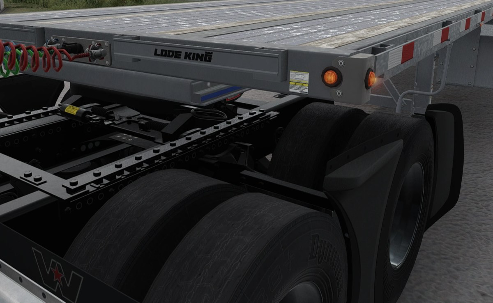
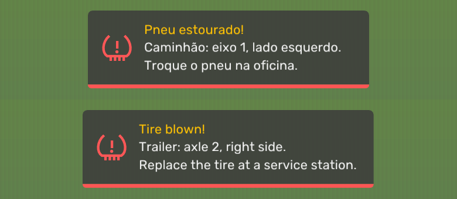
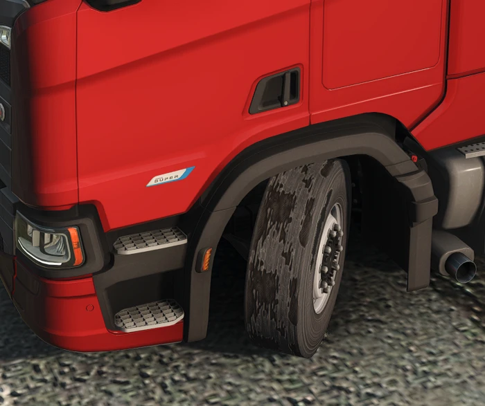
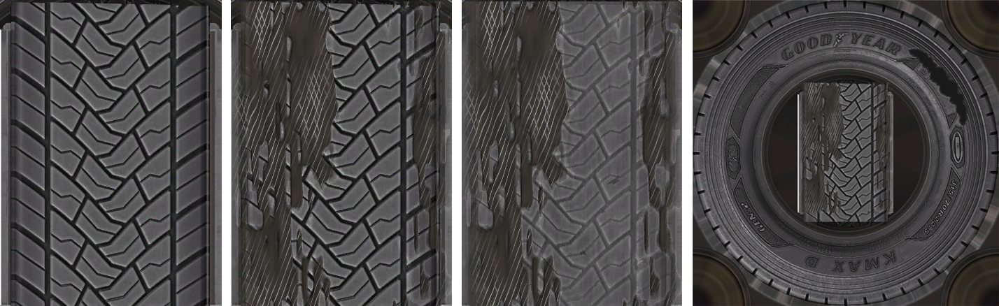

# ETS2 & ATS Tire Wear

**English** | [Português (Brasil)](README.pt-BR.md)

[](https://github.com/Rhaiderr/ets2-tire-wear/releases/latest/download/ets2-tire-wear.zip)
[](https://buymeacoffee.com/leonardoarouck)
[](#-pix-key-brazil)

**[⬇ Download the latest version (zip)](https://github.com/Rhaiderr/ets2-tire-wear/releases/latest/download/ets2-tire-wear.zip)** · [all versions](https://github.com/Rhaiderr/ets2-tire-wear/releases)

**Install:** copy **both files** from the zip, `ets2_tire_wear.dll` and `ets2_tire_wear.ini`, into `<game folder>\bin\win_x64\plugins\` (ETS2 or ATS) and start the game ([details](#installation)).

> **Beta release.** Tested on ETS2 1.61 and ATS 1.61, on the keyboard and a Logitech G923 wheel. Use it in single player, and back up your profile if you want to be extra safe.

> **Tires can blow out.** From 60% wear, a tire may blow while you drive: the truck pulls to one side and is held to 60 km/h until you replace the tires. This is on by default. To turn it off, set `[blowout] enabled = 0` in the INI ([details](#tire-blowouts)).

> **Tire mods are not supported yet.** Only the tires of the base game and of the official DLCs (Goodyear, Michelin) get the worn look. If you fit a tire from a mod, the plugin does not recognise it and its visual wear simply does not happen: that tire keeps its original look. Nothing breaks, and the other tires keep working.

A plugin for **Euro Truck Simulator 2** and **American Truck Simulator** that makes the tires of **your** truck and **your** trailers look worn according to the game's **real wear**. The game already tracks the wear of every wheel (you can see it in the service menu), but the tire always looks brand new. With this plugin the tread gradually loses its pattern until it is almost bald.


*The default ETS2 truck tire at the 8 wear levels. Images made with the project's preview tool, which runs exactly the plugin's code, under simulated lighting.*

### In the game

<p align="center">
  
  
</p>

*Screenshots from the game: worn rear tires of a truck in ETS2 (left) and of a Western Star in ATS (right).*

## What it does

- **Reads the wear from the official telemetry** (SCS Telemetry SDK): one value per truck and per trailer, from 0% to 100%.
- **Picks one of 8 levels** (0, 14, 29, 43, 57, 71, 86 and 100%). Level 0 is the game's own tire.
- **Wears only the tread**: the sidewall, its lettering and the rim stay untouched.
- **Only on your vehicles**: traffic keeps its new tires, in the mirrors too.
- **No game files are modified**: no `.scs` is changed. The worn textures are created in memory from the original ones while the game runs.
- **Tire blowouts**: badly worn tires can blow, with a notice, sounds, a shredded tire and an effect on the steering ([details](#tire-blowouts)).

### How the wear looks

| Wear | What changes |
|---|---|
| Low | Grooves get shallower and lighter; the coloured "new tire" stripe (some Michelin models) disappears |
| Medium | Greyish dust in the grooves, shoulders wear slower than the centre, the surface turns matte |
| High | Almost smooth charcoal surface with abrasion grain along the rolling direction, small chips, cupping, and the tread wear indicators (TWI) showing in the grooves |


*Labels in the images are in Portuguese: "liso" = plain, "com detalhe" = with detail, "sujeira nos sulcos" = dirt in the grooves, "grão, lascas e ondulação" = grain, chips and cupping.*

### American Truck Simulator

ATS has its own tires (American sizes and patterns); they get the same treatment.


## Tire blowouts

The game has no tire blowouts, so the plugin adds them. From 60% wear, each vehicle (the truck and each trailer) has a chance per kilometre of blowing a tire. The chance grows with the wear:

| Wear | Average distance until a blowout |
|---|---|
| up to 60% | never blows |
| 70% | ~19,000 km |
| 80% | ~2,400 km |
| 90% | ~700 km |
| 100% | ~300 km |

### When a tire blows

- **Notice** at the top of the screen, in the style of the game's own notices, saying which tire blew (vehicle, axle and side). It follows the game's language: Portuguese when the game is in Portuguese, English for every other language.

  

- **Sounds:** a bang, then the torn tire slapping the road in step with the wheel.
- **Shredded tire** on the blown wheel only: the steel belts show through the tread and the sidewall gets a gash of random size. All of it is drawn on top of the wear the tire already had.

  

  *In the game: blown front left tire on a Scania, on top of 86% wear.*

  

  *Goodyear KMAX D: new tread, blown at 0% wear, blown at 57%, and the sidewall with the gash. Images from the project's preview tool.*

- **Effect on the truck:**
  - **Truck tire:** a jolt towards the blown side, then the truck keeps pulling that way, with a light shake in the steering. It also drags.
  - **Trailer tire:** the truck only drags, with no pull on the steering.
  - **Drags** means less throttle and, with a trailer attached, the trailer brake at 35%, which does **not** light the brake lamps. Only at the blowout is there a short brake tap, and the lamps flash.
  - **Speed limit:** 60 km/h with a blown truck tire, and 70 km/h when only a trailer tire is blown. With an analog pedal, the throttle is gradually taken away near the limit. If you go 8 km/h over the limit and the speed is not dropping (downhill, for example), the brake comes in and the lamps light up. Right after a blowout at high speed the brake stays off: the throttle cut is already slowing the truck.

### Repair and turning it off

- **Repair:** replace the tires at a service station. The blowout ends when that vehicle's wear drops (by at least 5 points, or half the wear it had at the blowout, whichever is smaller). Until then, the blowout stays even if you quit and come back.
- **Multiplayer:** tires do not blow in Convoy or TruckersMP.
- **Turning it off:**
  - `[blowout] enabled = 0` turns blowouts off;
  - `[effect] enabled = 0` keeps blowouts (notice and shredded tire) but removes the effect on the truck and the sounds;
  - **Ctrl+Shift+B** in the game stops the effect and the slapping sound for the rest of the session.

Throttle and brakes are added to your pedals or keyboard through the official SCS SDK controls. No game memory is changed. On the **keyboard**, the game does not let the plugin take throttle away, so the speed limit only works through the brake, from 8 km/h over the limit.

### Force feedback wheels

On a force feedback wheel, the pull is a **force on the wheel itself**: it turns towards the blown tire and you hold it, as in a real blowout. The plugin finds the wheel the game uses (DirectInput) by itself and adds this force to the game's own force feedback. On the keyboard or a controller without force feedback, the pull is a steering offset instead.

> **Tested on a Logitech G923 only.** Other wheels the game drives through DirectInput (Logitech, Thrustmaster, Fanatec, Moza…) should work the same way but have not been tested yet. If you try another wheel, please open an [issue](../../issues) with your `game.log.txt` (`Documents\<game>\game.log.txt`): its `ffb:` lines show which device was picked.

- **Adjusting the force:** `ffb_pull` (steady pull, default `0.25`), `ffb_kick` (jolt at the blowout, `0.6`) and `ffb_wobble` (shake, `0.08`), as fractions of the wheel's full force. The same fraction is much stronger on a direct drive wheel than on a G923: start at half these values and go up step by step. Your wheel software's gain (G HUB, Fanalab…) counts too.
- **Force pushes the wrong way:** `ffb_invert = 1`.
- **The plugin picked another device** (a virtual joystick, for example) or did not find your wheel: put part of your wheel's name in `ffb_device` (for example `ffb_device = G923`). The name is in `game.log.txt`, on the `ffb:` lines.
- **No force on the wheel:** `ffb = 0` goes back to the steering offset.

## Compatibility

| Item | Status |
|---|---|
| Games | ETS2 **1.61** and ATS **1.61** (the only versions tested). The same DLL works in both: it checks which game loaded it |
| OS | Windows 10/11 64-bit |
| Renderer | **DirectX 11**; other modes are untested |
| Tires (ETS2) | All 33 texture pairs of the base game and the **Goodyear** and **Michelin** tire DLCs |
| Tires (ATS) | All 42 truck and trailer texture pairs of the base game, the **Goodyear** and **Michelin** tire DLCs and the Duty tire of the wheel DLC (`dlc_rims`) |
| Modded tires | **Not supported yet**: no visual wear, the tire keeps its original look |
| Modded trucks and trailers | Should work: telling yours from traffic uses the wheel positions, not the model |
| TruckersMP | **Not tested.** Blowouts turn themselves off in TruckersMP and in Convoy |
| Controls (blowouts) | Tested on the **keyboard** and a **Logitech G923** (force on the wheel). Other wheels: [see here](#force-feedback-wheels) |
| Other graphics mods | Tested alongside a lighting mod that also uses `dxgi.dll` / `dinput8.dll`, with no conflict |
| Performance | No FPS loss in tests. Each tire texture gets 7 worn versions on a background thread: ~0.15 s for 512 px and ~0.7 s for 1024 px, only when it loads. The shredded tire is made once per blowout, also on a background thread (~75 ms for 1024 px) |

## Installation

1. Download **[ets2-tire-wear.zip](https://github.com/Rhaiderr/ets2-tire-wear/releases/latest/download/ets2-tire-wear.zip)** (the latest version; older ones are in [Releases](https://github.com/Rhaiderr/ets2-tire-wear/releases)).
2. With the game **closed**, copy both files from the zip, `ets2_tire_wear.dll` and `ets2_tire_wear.ini`, to `<game folder>\bin\win_x64\plugins\`. Create the `plugins` folder if it does not exist.
   - ETS2 (Steam): `C:\Program Files (x86)\Steam\steamapps\common\Euro Truck Simulator 2\bin\win_x64\plugins\`
   - ATS (Steam): `C:\Program Files (x86)\Steam\steamapps\common\American Truck Simulator\bin\win_x64\plugins\`
   - Playing both? Copy the same two files into each game's `plugins` folder.
3. Start the game. The first time, it warns that a plugin uses advanced SDK features: click **OK**.

That's all: the tire catalogues of both games are built into the DLL, and the settings are the `ets2_tire_wear.ini` next to it. Logs and the blowout state go to a `TireWear` folder, created next to the game's profiles: `Documents\Euro Truck Simulator 2\TireWear\` or `Documents\American Truck Simulator\TireWear\`. Below, `Documents\<game>\TireWear` means the folder of the game you play.

Wear shows up as the tires wear in your save; a new tire looks unchanged. To see the effect right away, use `wear_override` (next section).

**Uninstall:** delete `ets2_tire_wear.dll` and `ets2_tire_wear.ini` from the `plugins` folder and the `Documents\<game>\TireWear` folder.

## Settings

The file is the `ets2_tire_wear.ini` in the `plugins` folder (it comes in the zip, one per game). Without it, the plugin creates and uses `Documents\<game>\TireWear\ets2_tire_wear.ini`, as in earlier versions; `game.log.txt` tells which one is in use (the `settings:` line). Every key has a comment explaining it. Edit it with the game closed.

| Section | Key | Default | Purpose |
|---|---|---|---|
| `[tires]` | `wear_levels` | `1` | Turns the worn tires on (`0` = off) |
| `[tires]` | `separate` | `1` | Only your vehicles wear (`0` also wears traffic, by texture folder) |
| `[tires]` | `levels` | `8` | Number of wear levels |
| `[tires]` | `wear_override` | `-1` | Testing: `0.0` to `1.0` forces that wear on every tire; `-1` uses the telemetry |
| `[present]` | `notice` | `1` | Notice at the top of the screen when a tire blows (`0` = off) |
| `[present]` | `notice_s`, `notice_top`, `notice_scale` | `8`, `60`, `1` | How long the notice stays (seconds), its gap from the top (in 1/900 of the screen height) and its size |
| `[present]` | `overlay` | `0` | Testing: `1` shows a panel in the corner with the average wear of the truck and each trailer, and the blown tires |
| `[blowout]` | `enabled` | `1` | Turns blowouts on (`0` = off) |
| `[blowout]` | `start_wear`, `km_at_100`, `curve` | `0.60`, `300`, `3` | The wear from which a tire can blow, the average distance until a blowout at 100%, and how fast the chance grows |
| `[blowout]` | `test_after_s` | `0` | Testing: blows a tire after that many seconds of driving (this session only). Pick the tire with `test_unit` (`truck` or `trailer`) and `test_wheel` (`-1` = random) |
| `[effect]` | `enabled` | `1` | The blowout's effect on the truck (pull, drag and speed limit) and its sounds (`0` = off) |
| `[effect]` | `pull`, `wobble` | `0.12`, `0.015` | Steering offset and shake, on the keyboard or without force feedback |
| `[effect]` | `ffb` | `1` | Force feedback wheel: the pull becomes a force on the wheel (`0` = steering offset) |
| `[effect]` | `ffb_pull`, `ffb_kick`, `ffb_wobble` | `0.25`, `0.6`, `0.08` | Strength of the pull, the jolt and the shake on the wheel (fraction of its full force) |
| `[effect]` | `ffb_invert`, `ffb_device` | `0`, empty | Flips the force; part of your wheel's name, if the plugin does not pick it by itself |
| `[effect]` | `limit_truck_kmh`, `limit_trailer_kmh` | `60`, `70` | Speed limit with a blown truck tire, or with only a blown trailer tire |
| `[effect]` | `sound`, `sound_volume`, `flap_volume` | `1`, `0.8`, `0.6` | Bang and slapping sounds (the plugin's own volume, `0` to `1`; not tied to the game's volume) |
| `[effect]` | `visual` | `1` | Shredded tire on the blown wheel |
| `[tires]` | `capture` | `0` | Diagnosis: writes the data of the drawn wheels to a `tire_capture_*.txt` file |
| `[tires]` | `tint_test` | `0` | Diagnosis: paints swapped tires magenta |
| `[present]`, `[tires]` | `probe`, `hook`, `log` | `1` | Must stay at `1` for the plugin to work |

An INI written by an older version lacks the new keys, so their defaults apply (blowouts and notice on). To change one, add the key to its section.

## Known limitations

- A single trailer wheel seen through the cab window may keep its original look.
- A truck identical to yours, **parked** right next to your mirror, may show worn tires in the reflection.
- Seen from very far away, the white stripe of some Michelin models (XZE) is still faintly visible.
- On some models, a thin light line in the middle of the tread disappears from 14% on.
- Right after loading, a tire may look original for a few frames until its worn versions are ready.
- Blowouts on the **keyboard**: the throttle is not limited (the game does not allow it), only the brake from 8 km/h over the limit.
- Force on the wheel tested on a G923 only. A wheel the game does not read through DirectInput, or that the plugin does not recognise (see `ffb_device`), gets the steering offset, which is felt the wrong way on a force feedback wheel.
- A blown tire does not sit lower and does not change the game's physics: the effect comes only from the steering, throttle and brakes.
- The notice's language is read when the game starts: if you change the language, restart the game.

## Issues and feedback

Open an [issue](../../issues) with:
- the game (ETS2 or ATS) and the file `Documents\<game>\TireWear\present_probe.log` (it lists file paths on your PC, which may include your Windows user name: check it before posting);
- the truck, trailer and tire you used;
- what happened, ideally with a screenshot.

## Building

Requirements: Visual Studio 2022 with C++, and CMake 3.20 or newer.

1. Download the **SCS Telemetry SDK** (1.14 or newer) from the [SCS modding documentation](https://modding.scssoft.com/wiki/Documentation/Engine/SDK/Telemetry) and extract it so that `third_party\scs_sdk\include\scssdk.h` exists. The SCS headers are not redistributed here.
2. In a *Developer PowerShell for VS 2022*:
   ```bash
   cmake -S . -B build -G "Visual Studio 17 2022" -A x64
   ```
   ```bash
   cmake --build build --config Release
   ```
3. The DLL ends up in `build\out\ets2_tire_wear.dll`. To build the release zip:
   ```bash
   powershell -File tools\package.ps1 -Version 0.3.0-beta
   ```

### Layout

| Folder | Contents |
|---|---|
| `src/` | The plugin: telemetry and input (`plugin.cpp`), D3D11/DXGI hooks (`present_probe.cpp`, `tire_probe.cpp`), wear transform and shredded tire (`wear_transform.cpp`), player vs traffic separation (`player_tracker.cpp`), blowouts (`blowout.cpp`), effect on the truck (`effect.cpp`), sound (`tire_audio.cpp`), notice (`notice.cpp`) and on-screen drawing (`overlay.cpp`) |
| `catalog/` | Per game (`ets2/`, `ats/`): tire texture hashes and the tread rectangle of each (built into the DLL) |
| `package/` | The zip's read-me |
| `tools/` | Dev tools: `wearpreview` (previews and transform benchmark, shredded tire included), `trackertest` (tests the separation on captures), `tirecat` (builds the catalogue from the game's extracted files), `blowoutsim` (simulates blowouts and the effect outside the game), `tiresound` (renders the sounds to a WAV), `noticepreview` (notice preview) |
| `third_party/` | MinHook 1.3.4 (BSD-2), Dear ImGui 1.92.9b (MIT) and the Rubik font (SIL OFL 1.1) |

## Support my work

I make free, open-source realism plugins for Euro Truck Simulator 2, built and maintained in my spare time. If you enjoy them and want to support new releases and updates, you can help:

[](https://buymeacoffee.com/leonardoarouck)

<div align="center">

### 🔑 Pix key (Brazil)

</div>

```
fe1a4c11-6bb5-4844-b687-1f9143512862
```

## Licences and credits

- This project: [MIT](LICENSE). The same file carries the notices of the two libraries built into the DLL: [MinHook](https://github.com/TsudaKageyu/minhook) (BSD 2-Clause) and [Dear ImGui](https://github.com/ocornut/imgui) (MIT).
- Notice font: [Rubik](https://github.com/googlefonts/rubik), built into the DLL, under the SIL Open Font License 1.1 (full text at the end of [LICENSE](LICENSE)).
- Euro Truck Simulator 2, American Truck Simulator, Goodyear and Michelin are trademarks of their owners. This project is not affiliated with SCS Software or the tire makers, and ships no game files.
