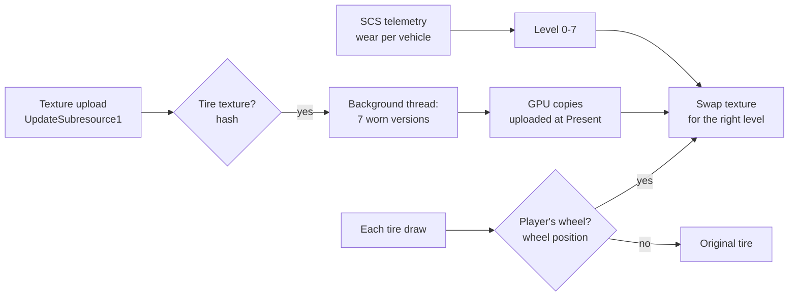

# ETS2 & ATS Tire Wear

**English** | [Português (Brasil)](README.pt-BR.md)

[](https://github.com/Rhaiderr/ets2-tire-wear/releases)

**Install:** copy `ets2_tire_wear.dll` from the zip into `<game folder>\bin\win_x64\plugins\` (ETS2 or ATS) and start the game ([details](#installation)).

> **Alpha release.** It works on my setup but is still being tested by other people. Use it in single player, and back up your profile if you want to be extra safe.

> **Tire mods are not supported yet.** Only the tires of the base game and of the official DLCs (Goodyear, Michelin) get the worn look. If you fit a tire from a mod, the plugin does not recognise it and its visual wear simply does not happen: that tire keeps its original look. Nothing breaks, and the other tires keep working.

A plugin for **Euro Truck Simulator 2** and **American Truck Simulator** that makes the tires of **your** truck and **your** trailers look worn according to the game's **real wear**. The game already tracks the wear of every wheel (you can see it in the service menu), but the tire always looks brand new. With this plugin the tread gradually loses its pattern until it is almost bald.


*The default ETS2 truck tire at the 8 wear levels. Images made with the project's preview tool, which runs exactly the plugin's code, under simulated lighting.*

## What it does

- **Reads the wear from the official telemetry** (SCS Telemetry SDK): one value per truck and per trailer, from 0% to 100%.
- **Picks one of 8 levels** (0, 14, 29, 43, 57, 71, 86 and 100%). Level 0 is the game's own tire.
- **Wears only the tread**: the sidewall, its lettering and the rim stay untouched.
- **Only on your vehicles**: traffic keeps its new tires, in the mirrors too.
- **No game files are modified**: no `.scs` is changed. The worn textures are created in memory from the original ones while the game runs.

### How the wear looks

| Wear | What changes |
|---|---|
| Low | Grooves get shallower and lighter; the coloured "new tire" stripe (some Michelin models) disappears |
| Medium | Greyish dust in the grooves, shoulders wear slower than the centre, the surface turns matte |
| High | Almost smooth charcoal surface with abrasion grain along the rolling direction, small chips, cupping, and the tread wear indicators (TWI) showing in the grooves |


*Labels in the images are in Portuguese: "liso" = plain, "com detalhe" = with detail, "sujeira nos sulcos" = dirt in the grooves, "grão, lascas e ondulação" = grain, chips and cupping.*

### American Truck Simulator

ATS has its own tires (American sizes and patterns); they get the same treatment.


## Compatibility

| Item | Status |
|---|---|
| Games | ETS2 **1.61** and ATS **1.61** (the only versions tested). The same DLL works in both: it checks which game loaded it |
| OS | Windows 10/11 64-bit |
| Renderer | **DirectX 11**; other modes are untested |
| Tires (ETS2) | All 33 texture pairs of the base game and the **Goodyear** and **Michelin** tire DLCs |
| Tires (ATS) | All 42 truck and trailer texture pairs of the base game, the **Goodyear** and **Michelin** tire DLCs and the Duty tire of the wheel DLC (`dlc_rims`) |
| Modded tires | **Not supported yet**: no visual wear, the tire keeps its original look |
| Modded trucks and trailers | Should work: telling yours from traffic uses the wheel positions, not the model |
| TruckersMP | **Not tested** |
| Other graphics mods | Tested alongside a lighting mod that also uses `dxgi.dll` / `dinput8.dll`, with no conflict |
| Performance | No FPS loss in tests. Each tire texture gets 7 worn versions on a background thread: ~0.15 s for 512 px and ~0.7 s for 1024 px, only when it loads |

## Installation

1. Download the latest `.zip` from **[Releases](https://github.com/Rhaiderr/ets2-tire-wear/releases)**.
2. With the game **closed**, copy `ets2_tire_wear.dll` to `<game folder>\bin\win_x64\plugins\`. Create the `plugins` folder if it does not exist.
   - ETS2 (Steam): `C:\Program Files (x86)\Steam\steamapps\common\Euro Truck Simulator 2\bin\win_x64\plugins\`
   - ATS (Steam): `C:\Program Files (x86)\Steam\steamapps\common\American Truck Simulator\bin\win_x64\plugins\`
   - Playing both? Copy the same DLL into each game's `plugins` folder.
3. Start the game. The first time, it warns that a plugin uses advanced SDK features: click **OK**.

That's all: the tire catalogues of both games are built into the DLL. On the first run the plugin creates a `TireWear` folder for its settings and logs next to the game's profiles: `Documents\Euro Truck Simulator 2\TireWear\` or `Documents\American Truck Simulator\TireWear\`. Below, `Documents\<game>\TireWear` means the folder of the game you play.

Wear shows up as the tires wear in your save; a new tire looks unchanged. To see the effect right away, use `wear_override` (next section).

**Uninstall:** delete `ets2_tire_wear.dll` from the `plugins` folder and the `Documents\<game>\TireWear` folder.

## Settings

The file is `Documents\<game>\TireWear\ets2_tire_wear.ini` (one per game), created with the defaults below on the first run. Edit it with the game closed.

| Key | Default | Purpose |
|---|---|---|
| `wear_levels` | `1` | Turns the worn tires on (`0` = off) |
| `separate` | `1` | Only your vehicles wear (`0` also wears traffic, by texture folder) |
| `levels` | `8` | Number of wear levels |
| `wear_override` | `-1` | Testing: `0.0` to `1.0` forces that wear on every tire; `-1` uses the telemetry |
| `overlay` | `0` | `1` shows a small panel with the average wear of the truck and each trailer |
| `capture` | `0` | Diagnosis: writes the data of the drawn wheels to a `tire_capture_*.txt` file |
| `tint_test` | `0` | Diagnosis: paints swapped tires magenta |
| `probe`, `hook`, `log` | `1` | Must stay at `1` for the plugin to work |

## How it works



1. **Recognition:** the plugin hooks (with [MinHook](https://github.com/TsudaKageyu/minhook)) the texture uploads to the GPU and compares each one against a catalogue of hashes of the game's tire textures (`catalog/ets2/` or `catalog/ats/tire_textures.csv`, picked by the game that loaded the plugin and built into the DLL; a file of the same name in the `TireWear` folder overrides it). No game files are shipped: the catalogue only holds hashes and names.
2. **Worn textures:** each recognised tire gets 7 increasingly worn copies. Only the tread area, defined in `catalog/<game>/tire_regions.csv`, changes. Colour and relief (normal map) are recomputed pixel by pixel and re-compressed to BC3/BC5. This runs on a background thread so the game does not stutter.
3. **Whose wheel is it:** at every tire draw, the plugin reads the wheel's position relative to the camera and recognises the wheel set of your truck and trailers: from the distances between wheels, from the pose given by the telemetry and, in the mirrors, from wheel pairs. Wheels that do not match your vehicles are traffic and stay as they are.
4. **Swap:** if the wheel is yours, that draw gets the texture of the current wear level.

## Known limitations

- A single trailer wheel seen through the cab window may keep its original look.
- A truck identical to yours, **parked** right next to your mirror, may show worn tires in the reflection.
- Seen from very far away, the white stripe of some Michelin models (XZE) is still faintly visible.
- On some models, a thin light line in the middle of the tread disappears from 14% on.
- Right after loading, a tire may look original for a few frames until its worn versions are ready.

## Issues and feedback

Open an [issue](../../issues) with:
- the game (ETS2 or ATS) and the file `Documents\<game>\TireWear\present_probe.log` (it lists file paths on your PC, which may include your Windows user name: check it before posting);
- the truck, trailer and tire you used;
- what happened, ideally with a screenshot.

## Building

Requirements: Visual Studio 2022 with C++, and CMake 3.20 or newer.

1. Download the **SCS Telemetry SDK** (1.14 or newer) from the [SCS modding documentation](https://modding.scssoft.com/wiki/Documentation/Engine/SDK/Telemetry) and extract it so that `third_party\scs_sdk\include\scssdk.h` exists. The SCS headers are not redistributed here.
2. In a *Developer PowerShell for VS 2022*:
   ```bash
   cmake -S . -B build -G "Visual Studio 17 2022" -A x64
   ```
   ```bash
   cmake --build build --config Release
   ```
3. The DLL ends up in `build\out\ets2_tire_wear.dll`. To build the release zip:
   ```bash
   powershell -File tools\package.ps1 -Version 0.2.0-alpha
   ```

### Layout

| Folder | Contents |
|---|---|
| `src/` | The plugin: telemetry (`plugin.cpp`), D3D11/DXGI hooks (`present_probe.cpp`, `tire_probe.cpp`), wear transform (`wear_transform.cpp`), player vs traffic separation (`player_tracker.cpp`), optional panel (`overlay.cpp`) |
| `catalog/` | Per game (`ets2/`, `ats/`): tire texture hashes and the tread rectangle of each (built into the DLL) |
| `package/` | The zip's read-me |
| `tools/` | Dev tools: `wearpreview` (previews and transform benchmark), `trackertest` (tests the separation on captures), `tirecat` (builds the catalogue from the game's extracted files) |
| `third_party/` | MinHook 1.3.4 (BSD-2) and Dear ImGui 1.92.9b (MIT) |

## Licences and credits

- This project: [MIT](LICENSE). The same file carries the notices of the two libraries built into the DLL: [MinHook](https://github.com/TsudaKageyu/minhook) (BSD 2-Clause) and [Dear ImGui](https://github.com/ocornut/imgui) (MIT).
- Euro Truck Simulator 2, American Truck Simulator, Goodyear and Michelin are trademarks of their owners. This project is not affiliated with SCS Software or the tire makers, and ships no game files.
