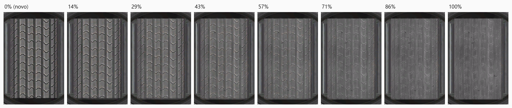
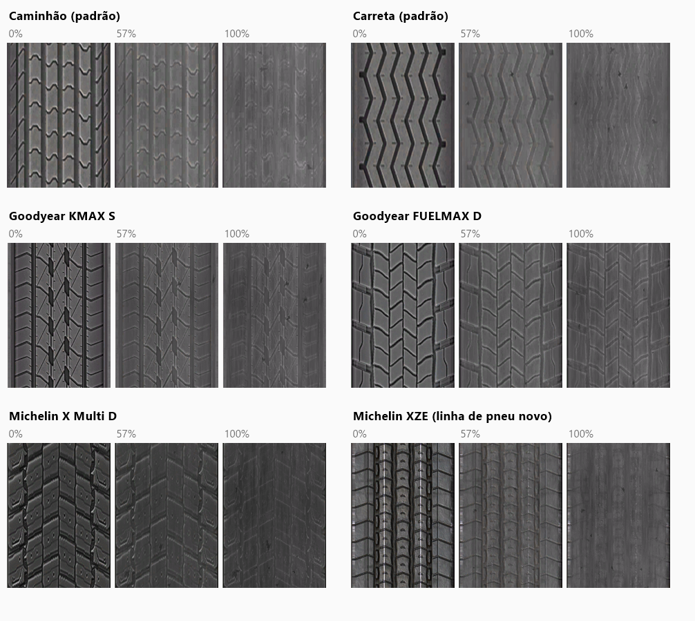
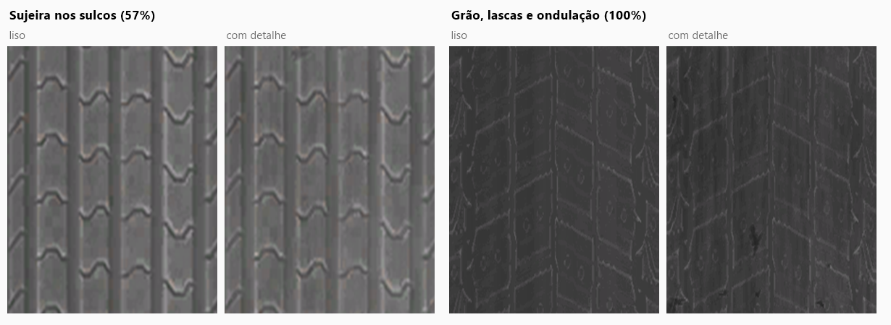
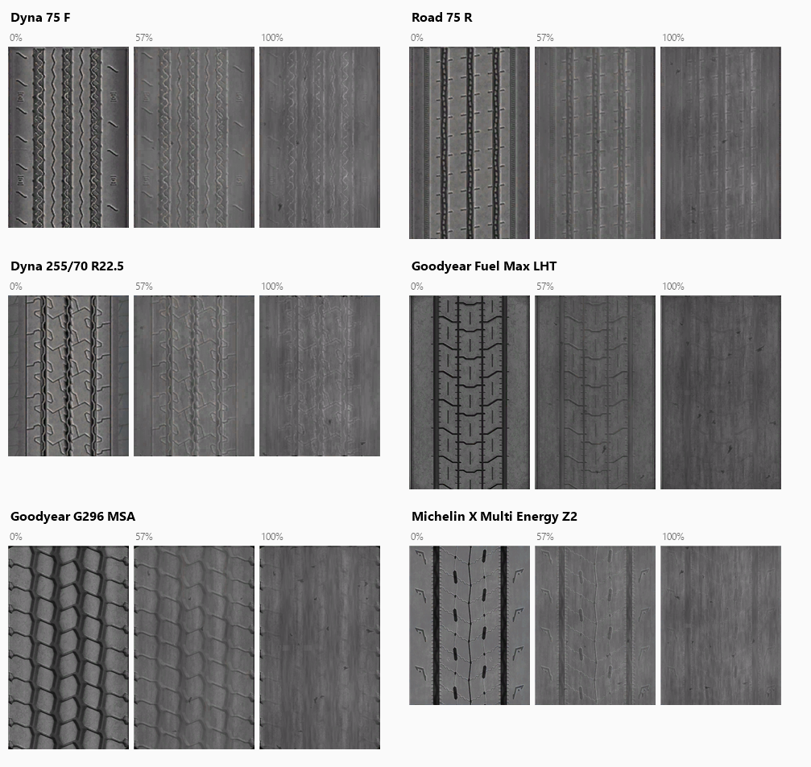
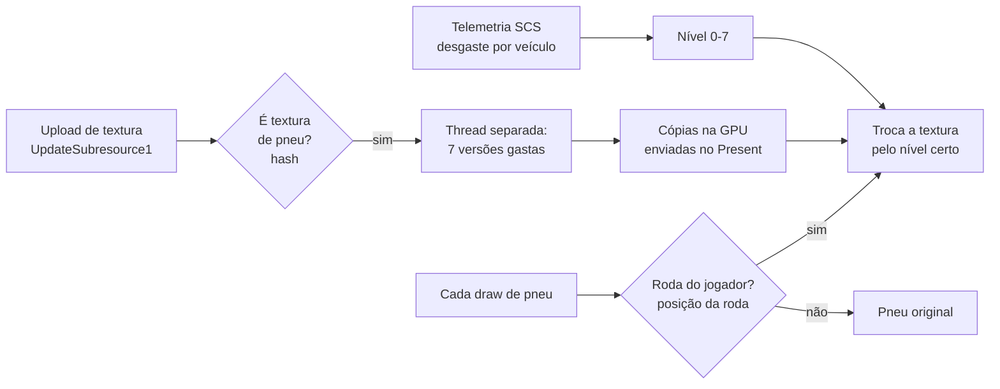

# ETS2 & ATS Tire Wear

[English](README.md) | **Português (Brasil)**

[](https://github.com/Rhaiderr/ets2-tire-wear/releases)

**Instalar:** copie o `ets2_tire_wear.dll` do zip para `<pasta do jogo>\bin\win_x64\plugins\` (ETS2 ou ATS) e abra o jogo ([detalhes](#instalação)).

> **Versão alpha.** Funciona no meu ambiente, mas ainda está sendo testada com outras pessoas. Use em single player e faça backup do seu perfil se quiser segurança extra.

> **Pneus de mods ainda não são compatíveis.** Só os pneus do jogo base e das DLCs oficiais (Goodyear, Michelin) ganham a aparência gasta. Se você colocar um pneu de mod, o plugin não o reconhece e o desgaste visual simplesmente não acontece: esse pneu fica com a aparência original. Nada quebra, e os outros pneus continuam funcionando.

Plugin para **Euro Truck Simulator 2** e **American Truck Simulator** que mostra os pneus do **seu** caminhão e das **suas** carretas gastos de acordo com o **desgaste real** do jogo. O jogo já calcula o desgaste de cada roda (você vê no menu de manutenção), mas o pneu continua visualmente novo. Com o plugin, a banda de rodagem vai perdendo o desenho até ficar quase lisa.



*Pneu padrão do caminhão do ETS2 nos 8 níveis de desgaste. Imagens geradas pela ferramenta de prévia do projeto, que usa exatamente o mesmo código do plugin, com uma luz simulada.*

## O que ele faz

- **Lê o desgaste pela telemetria oficial** (SCS Telemetry SDK): um valor por caminhão e por carreta, de 0% a 100%.
- **Escolhe um de 8 níveis** (0, 14, 29, 43, 57, 71, 86 e 100%). O nível 0 é o pneu original do jogo.
- **Gasta só a banda de rodagem**: a lateral do pneu, as letras e o aro ficam intactos.
- **Só nos seus veículos**: os pneus do tráfego continuam novos, e isso vale também nos retrovisores.
- **Sem arquivos do jogo modificados**: nenhum `.scs` é alterado. As texturas gastas são criadas na memória, a partir das texturas originais, enquanto o jogo roda.

### Como o desgaste aparece

| Desgaste | O que muda |
|---|---|
| Baixo | Os sulcos começam a ficar rasos e mais claros, e a linha colorida de "pneu novo" (alguns Michelin) some |
| Médio | Poeira acinzentada nos sulcos, os ombros se desgastam menos que o centro e o brilho fica mais fosco |
| Alto | Superfície quase lisa, cor de carvão, com grão de abrasão no sentido do giro, pequenas lascas, ondulação e indicadores de desgaste (TWI) aparecendo nos sulcos |





### American Truck Simulator

O ATS tem pneus próprios (medidas e desenhos americanos), e eles recebem o mesmo tratamento.



## Compatibilidade

| Item | Situação |
|---|---|
| Jogos | ETS2 **1.61** e ATS **1.61** (únicas versões testadas). A mesma DLL serve nos dois: ela vê qual jogo a carregou |
| Sistema | Windows 10/11 64 bits |
| Renderização | **DirectX 11**; outros modos não foram testados |
| Pneus (ETS2) | Os 33 pares de textura do jogo base e das DLCs de pneus **Goodyear** e **Michelin** |
| Pneus (ATS) | Os 42 pares de textura de caminhão e carreta do jogo base, das DLCs de pneus **Goodyear** e **Michelin** e o pneu Duty da DLC de rodas (`dlc_rims`) |
| Pneus de mods | **Ainda não são compatíveis**: sem desgaste visual, o pneu fica com a aparência original |
| Caminhões e carretas de mods | Devem funcionar, porque a separação jogador × tráfego usa a posição das rodas e não o modelo |
| TruckersMP | **Não testado** |
| Outros mods gráficos | Testado junto com um mod de iluminação que também usa `dxgi.dll` / `dinput8.dll` sem conflito |
| Desempenho | Sem perda de FPS nos testes. Cada textura de pneu gera 7 versões gastas numa thread separada: ~0,15 s para 512 px, ~0,7 s para 1024 px, só no carregamento |

## Instalação

1. Baixe o `.zip` mais recente em **[Releases](https://github.com/Rhaiderr/ets2-tire-wear/releases)**.
2. Com o jogo **fechado**, copie `ets2_tire_wear.dll` para `<pasta do jogo>\bin\win_x64\plugins\`. Crie a pasta `plugins` se ela não existir.
   - ETS2 (Steam): `C:\Program Files (x86)\Steam\steamapps\common\Euro Truck Simulator 2\bin\win_x64\plugins\`
   - ATS (Steam): `C:\Program Files (x86)\Steam\steamapps\common\American Truck Simulator\bin\win_x64\plugins\`
   - Joga os dois? Copie a mesma DLL para a pasta `plugins` de cada jogo.
3. Abra o jogo. Na primeira vez aparece o aviso de que um plugin usa recursos avançados do SDK: confirme com **OK**.

Só isso: os catálogos de pneus dos dois jogos vêm dentro da DLL. Na primeira execução o plugin cria uma pasta `TireWear` para a configuração e os logs, junto dos perfis do jogo: `Documentos\Euro Truck Simulator 2\TireWear\` ou `Documentos\American Truck Simulator\TireWear\`. Daqui em diante, `Documentos\<jogo>\TireWear` é a pasta do jogo que você usa.

O desgaste aparece conforme o pneu desgasta no seu save. Num pneu novo não muda nada. Para ver o efeito na hora, use `wear_override` (próxima seção).

**Desinstalar:** apague `ets2_tire_wear.dll` da pasta `plugins` e a pasta `Documentos\<jogo>\TireWear`.

## Configuração

O arquivo fica em `Documentos\<jogo>\TireWear\ets2_tire_wear.ini` (um por jogo) e é criado com os valores padrão abaixo na primeira execução. Edite com o jogo fechado.

| Chave | Padrão | Para que serve |
|---|---|---|
| `wear_levels` | `1` | Liga os pneus gastos (`0` desliga) |
| `separate` | `1` | Só os seus veículos gastam (`0` gasta também o tráfego, pela regra da pasta da textura) |
| `levels` | `8` | Quantidade de níveis de desgaste |
| `wear_override` | `-1` | Teste: `0.0` a `1.0` força esse desgaste em todos os pneus; `-1` usa a telemetria |
| `overlay` | `0` | `1` mostra um painel com o desgaste médio do caminhão e de cada carreta |
| `capture` | `0` | Diagnóstico: grava os dados das rodas desenhadas num arquivo `tire_capture_*.txt` |
| `tint_test` | `0` | Diagnóstico: pinta os pneus trocados de magenta |
| `probe`, `hook`, `log` | `1` | Precisam ficar em `1` para o plugin funcionar |

## Como funciona



1. **Reconhecimento:** o plugin intercepta (com [MinHook](https://github.com/TsudaKageyu/minhook)) o envio de texturas para a placa de vídeo e compara cada uma com um catálogo de hashes das texturas de pneu do jogo (`catalog/ets2/` ou `catalog/ats/tire_textures.csv`, escolhido conforme o jogo que carregou o plugin e embutido na DLL; um arquivo com o mesmo nome na pasta `TireWear` tem prioridade). Nenhum arquivo do jogo vai junto: o catálogo tem só hashes e nomes.
2. **Texturas gastas:** para cada pneu reconhecido, gera 7 cópias com desgaste crescente. Só a área da banda de rodagem muda, definida em `catalog/<jogo>/tire_regions.csv`. A cor e o relevo (mapa normal) são recalculados pixel a pixel e recomprimidos em BC3/BC5. Isso roda numa thread separada para não travar o jogo.
3. **De quem é a roda:** a cada desenho de pneu, o plugin lê a posição da roda em relação à câmera e reconhece o conjunto de rodas do caminhão e das carretas: pela distância entre elas, pela pose vinda da telemetria e, nos retrovisores, por pares de rodas. Rodas que não batem com os seus veículos são tráfego e ficam como estão.
4. **Troca:** se a roda é sua, a textura daquele desenho é trocada pela versão do nível de desgaste atual.

## Limitações conhecidas

- Uma roda isolada da carreta, vista pela janela da cabine, pode ficar com a aparência original.
- Um caminhão idêntico ao seu, **parado** colado no retrovisor, pode aparecer com o pneu gasto no reflexo.
- Visto de muito longe, a linha branca de alguns Michelin (XZE) ainda aparece fraca.
- Em alguns modelos, uma linha clara fina no centro da banda some a partir de 14%.
- Logo depois de carregar, o pneu pode ficar original por alguns frames, até as versões gastas ficarem prontas.

## Problemas e feedback

Abra uma [issue](../../issues) com:
- o jogo (ETS2 ou ATS) e o arquivo `Documentos\<jogo>\TireWear\present_probe.log` (ele lista caminhos de arquivos do seu PC, que podem conter seu nome de usuário do Windows: revise antes de postar);
- o caminhão, a carreta e o pneu usados;
- o que aconteceu, de preferência com um print.

## Compilar

Requisitos: Visual Studio 2022 com C++ e CMake 3.20 ou mais novo.

1. Baixe o **SCS Telemetry SDK** (1.14 ou mais novo) na [documentação de modding da SCS](https://modding.scssoft.com/wiki/Documentation/Engine/SDK/Telemetry) e extraia de modo que exista `third_party\scs_sdk\include\scssdk.h`. Os headers da SCS não são distribuídos aqui.
2. Num *Developer PowerShell for VS 2022*:
   ```bash
   cmake -S . -B build -G "Visual Studio 17 2022" -A x64
   ```
   ```bash
   cmake --build build --config Release
   ```
3. A DLL fica em `build\out\ets2_tire_wear.dll`. Para montar o zip de release:
   ```bash
   powershell -File tools\package.ps1 -Version 0.2.0-alpha
   ```

### Estrutura

| Pasta | Conteúdo |
|---|---|
| `src/` | Plugin: telemetria (`plugin.cpp`), hooks D3D11/DXGI (`present_probe.cpp`, `tire_probe.cpp`), transformação de desgaste (`wear_transform.cpp`), separação jogador × tráfego (`player_tracker.cpp`) e painel opcional (`overlay.cpp`) |
| `catalog/` | Por jogo (`ets2/`, `ats/`): hashes das texturas de pneu e retângulo da banda de cada uma (embutidos na DLL) |
| `package/` | LEIA-ME do zip |
| `tools/` | Ferramentas de desenvolvimento: `wearpreview` (prévias e benchmark da transformação), `trackertest` (testa a separação com capturas), `tirecat` (gera o catálogo a partir dos arquivos extraídos do jogo) |
| `third_party/` | MinHook 1.3.4 (BSD-2) e Dear ImGui 1.92.9b (MIT) |

## Licenças e créditos

- Este projeto: [MIT](LICENSE). O mesmo arquivo traz os avisos das duas bibliotecas embutidas na DLL: [MinHook](https://github.com/TsudaKageyu/minhook) (BSD 2-Clause) e [Dear ImGui](https://github.com/ocornut/imgui) (MIT).
- Euro Truck Simulator 2, American Truck Simulator, Goodyear e Michelin são marcas dos seus donos. Este projeto não tem ligação com a SCS Software nem com os fabricantes de pneus, e não distribui arquivos do jogo.
